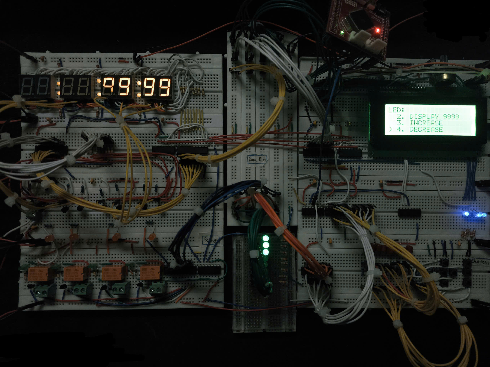

# ATmega128A memory-mapped I/O project



## Current firmware

The simpler PROJECT 01 application is now the main project in
src/main/main.c. Build it with make and flash output/main.hex.
main.c handles startup and a simple welcome/menu polling loop with a 10 ms delay.
welcome.c handles the welcome screen and scrolling; menu.c handles navigation.
The main firmware has no Timer1 scheduler or clock module. Timer0 refreshes
the multiplexed LEDs and Timer2 drives the buzzer.
menu.c connects nested linked lists to callbacks in the LED and relay modules,
following the structure of ../exam_atmega128. See
[the code walkthrough](references/code_structure.md) for the flow and edit locations.
make test builds the separate src/test/test.c copy to output/test.hex;
it is not the primary image for ongoing project updates.

The main application provides:
- PROJECT 01 on LCD row 2 and `the content` scrolling back and forth on row 3.
- Any-button entry to vertical DEVICES menu with 7-SEGMENT LED and RELAY entries.
- UP/DOWN selection, GO/RIGHT entry, LEFT back, and BTN1 exit, with no
  operating instructions printed on the screen.
- Four LED functions on the rightmost four of eight digits: 0000, 9999,
  INCREASE by each UP press, and DECREASE by each DOWN press.
- Values bounded to 0000..9999; no automatic counting.
- Four independent relay selections (Q0..Q3), each with ON/OFF controls.
  Relay 1 retains its existing buzzer linkage.
- All four relay channels configured active HIGH: LOW = OFF, HIGH = ON.
- Eight-digit physical order Q7..Q0 from left to right; segment order
  Q0..Q7 = DP,g,f,e,d,c,a,b.

Scroll steps use 25 polling iterations, with 100 iterations at either end
(approximately 250 ms and 1 second, plus LCD and interrupt overhead).
The earlier clock/full menu source is saved in
tmp/legacy_main_before_simple_project.c.saved.
Historical sections below may describe features of that earlier application.

Build with avr-gcc, avr-libc, and make in Linux/WSL. Firmware assumes an
actual 16 MHz CPU and a 20x4 HD44780-compatible LCD.
## Current wiring and map

PG0 = WR_L, PG1 = RD_L, PG2 = ALE, PG3 = LCD E, PG4 = dedicated LCD RS.
RS is disconnected from address-latch A0. LCD R/W is grounded.
Button latch U4 OE connects to PG1/RD_L with a 10 kΩ pull-up to +5 V;
LE is NOR(RD_L, CSEL0). Do not ground U4 OE. Six active-HIGH button inputs
are fitted; unused U4 D6/D7 inputs are grounded, not the shared data bus.

| Register | Address | Function |
|---|---|---|
| CSEL0 | 0x1100 | Buttons: LEFT, RIGHT, UP, DOWN, GO, BTN1 on bits 0..5 |
| CSEL1 | 0x1101 | LCD character-data latch write |
| CSEL2 | 0x1102 | LCD command latch write |
| CSEL3 | 0x1103 | Seven-segment data, corrected from physical testing |
| CSEL4 | 0x1104 | Digit enables, bits 0..7; Q7 leftmost and Q0 rightmost |
| CSEL5 | 0x1105 | Shared latch: Q0..Q3 relays, Q4 buzzer waveform, Q5..Q7 reserved |

Common-cathode segments use active-HIGH drive. Current segment-latch mapping (latest a/b correction awaits board verification):

| Output / data bit | Q0 | Q1 | Q2 | Q3 | Q4 | Q5 | Q6 | Q7 |
|---|---|---|---|---|---|---|---|---|
| Segment | DP | g | f | e | d | c | a | b |

An 8 without DP is FE; with DP it is FF. All displays share like-named
segment lines through the segment resistors. Each digit's common cathode
connects separately to its own transistor collector. MCU data-bus D0..D7
connect to latch D0..D7; segment connections come from the Q outputs.

## Menu and clock

Press/release any button at welcome to open the main menu.
UP/DOWN select, GO/RIGHT enter, LEFT returns, BTN1 exits to welcome.

Select `7-SEGMENT LED` -> `CURRENT TIME` to show HH.MM.SS. The software
clock starts at 12:00:00 after reset and continues running in the background.
It is not a battery-backed or synchronized wall clock. Decimal points are enabled after physical positions 4 and 6; the two leftmost digits are blank.

`ADJUST CLOCK`: LEFT/RIGHT select a digit; UP/DOWN change its value;
GO saves and resumes the clock; BTN1 cancels and returns to welcome.
Values are clamped to 23:59:59. `COUNT UP` and `MODE 4 (88888888)` also drive
the physical seven-segment display. The display starts blank until a function
is selected and retains its last buffer when an action is exited.

In the test, Timer0 scans digits every 1 ms (125 Hz per digit) and supplies the only one-second clock tick (1000 interrupts). Timer1 supplies 10 ms button/menu ticks.
LCD transfers protect RS/data/E against ISR bus accesses. Multi-digit
clock-buffer updates are atomic against scanning. The current main application instead uses a simple polling delay and Timer0 scanning without a clock tick.

## Relay devices and passive buzzer

Both `make test` and `make` now drive the real relay/buzzer latch.
Select RELAYS, then one of:

1. RELAY 1: BUZZER — U13 Q0 controls relay module 1; U13 Q4 drives buzzer I/O.
2. RELAY 2: DEVICE — U13 Q1, reserved external device.
3. RELAY 3: DEVICE — U13 Q2, reserved external device.
4. RELAY 4: DEVICE — U13 Q3, reserved external device.
5. ALL DEVICES OFF — stop the tone and turn all four relays off.

Entering an individual screen does not switch the relay. GO toggles it,
UP turns it ON, DOWN turns it OFF. LEFT returns and BTN1 exits to welcome;
those navigation actions retain relay states. Use ALL DEVICES OFF to stop
everything. Holding GO does not repeatedly toggle the contacts. LCD shows
software-commanded state, not measured relay-contact feedback.

Default relay inputs are active HIGH (`RELAY_ACTIVE_LOW_MASK = 0x00` in
`src/app/relay.h`): LOW is OFF, HIGH is ON. The logical API uses 1 = ON.
If future channels use bare NPN transistor coil drivers (active HIGH),
clear their corresponding mask bits. For example 0x01 means only relay 1
is active LOW, with relays 2–4 active HIGH. Do not assume both circuits
have the same polarity.

### Wiring assumed by the buzzer function

| Connection | Wire to |
|---|---|
| U13 Q0, pin 19 | Active-LOW relay module 1 IN |
| Relay module VCC / GND | +5 V / MCU GND |
| Relay COM | Buzzer module's rated external supply + |
| Relay NO | Buzzer module VCC |
| Buzzer module GND | External supply − and MCU GND |
| U13 Q4, pin 15 | Passive buzzer module I/O, accepting 5 V logic |

Q4 here is the latch output, NOT MCU PG4; PG4 remains LCD RS.
This function assumes the passive buzzer's VCC is switched by relay 1.
Its signal stays LOW while that supply is OFF to avoid feeding an unpowered
module from a HIGH input. Therefore Q4 LOW with relay 1 OFF is intentional,
not an enabled tone. Do not use this power-off behavior with an always-
powered active buzzer module. Voltage/input compatibility and the buzzer's
resonant frequency still need verification against its actual specifications.

Relay 1 ON starts the restored phone-style alarm after about 20 ms of
settling. Three rising 880/1175/1568 Hz phrases repeat with a 900 ms final
pause; the cycle lasts about 2.84 seconds. This is a passive-buzzer
approximation, not an exact iPhone recording.
The LCD shows ALARM ON. OFF or ALL DEVICES OFF stops it immediately.
Relay 1 remains steadily ON; only latch Q4 generates the audio signal.
Q4 is HIGH during powered quiet gaps and LOW while relay 1 removes power.
Timer0 display/clock scanning and Timer1 menu polling are retained.
The earlier melody was reported silent; this restoration is at the user's
request and still requires a physical-board sound check.
One volatile eight-bit state owns all CSEL5 outputs. Atomic relay writes
preserve the tone phase and reserved Q5..Q7 levels; Timer2 toggles only Q4
and preserves all relay states. Relay outputs are initialized OFF before
LCD initialization delays. This does not establish safe output levels during
hardware reset before firmware runs; reset behavior remains a hardware concern.
## Saved diagnostics and remaining checks

The successful 0–9 source is saved at `tmp/verified_0_to_9_test.c.saved`.
Other diagnostic sources remain in tmp; they are excluded from normal builds.
The user confirmed numerical glyphs on the physical displays. The restored
multiplexed clock/menu should now be verified on the board. Earlier rapid-
reset LCD corruption remains separately recorded; successful glyph tests
alone do not establish that reset reliability is solved. The LCD recovered
after an accidental VCC-to-GND short and restart; no permanent damage was
established.

See [debugging notes](gpt_note.md) and
[real board versus Proteus](references/real_board_vs_proteus.md) for history.

## Host regression checks

These use simulated registers and outputs; they do not verify electrical
timing or physical interrupt latency.

```sh
gcc -std=c99 -Wall -Wextra -Werror -fsanitize=address,undefined \
  -Itests/support -Isrc/app -Isrc/common -Isrc/drivers \
  tests/menu_buttons_test.c \
  -o /tmp/atmega-menu-test
/tmp/atmega-menu-test

gcc -std=c99 -Wall -Wextra -Werror -fsanitize=address,undefined \
  -Itests/support -Isrc/app -Isrc/common \
  tests/clock_display_test.c -o /tmp/atmega-clock-test
/tmp/atmega-clock-test

gcc -std=c99 -Wall -Wextra -Werror -fsanitize=address,undefined \
  -Itests/support -Isrc/app -Isrc/common \
  tests/relay_buzzer_test.c -o /tmp/atmega-relay-test
/tmp/atmega-relay-test
```

## LCD driver optimization

The LCD driver shares one atomic RS/data/E transfer routine and uses the
AVR register definitions for PG3/PG4. Call LCD functions only from main
context; ISRs may access the shared bus but must not call the LCD API.
Execution waits occur after restoring the caller's interrupt state.

Ordinary commands and data wait 60 us. Clear and return-home commands
(including raw commands 0x01, 0x02, and 0x03) wait 3 ms. These waits include
margin over the HD44780U's 270 kHz timings for a 190 kHz controller oscillator;
R/W is grounded, so firmware cannot poll the busy flag. The conservative
startup sequence is retained because rapid-reset recovery remains unverified.
The 20x4 cursor row bases are computed without an SRAM lookup table.

Compared with the previous driver, both firmware images use 52 fewer bytes
of flash and 4 fewer bytes of SRAM with the current avr-gcc -Os build.
The programmed clear delay drops from 10.1 ms to 3 ms, excluding bus pulse
and function overhead. Data waits increase from 50 to 60 us for oscillator
and address-counter margin. Verify screen transitions and repeated resets on
the physical board before treating timing/recovery as confirmed.

Additional host driver regression (simulated GPIO, bus, and delays):

```sh
gcc -std=c99 -Wall -Wextra -Werror -fsanitize=address,undefined \
  -Itests/support -Isrc/app -Isrc/common -Isrc/drivers \
  tests/lcd_driver_test.c -o /tmp/atmega-lcd-test
/tmp/atmega-lcd-test
```

Timing reference: [Hitachi HD44780U datasheet, instruction tables and oscillator characteristics](https://cdn-shop.adafruit.com/datasheets/HD44780.pdf).
